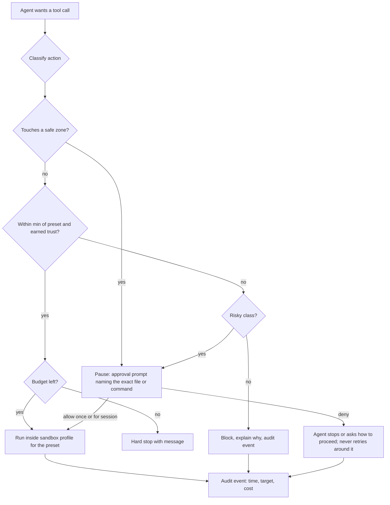
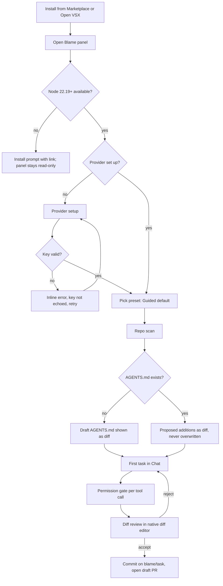
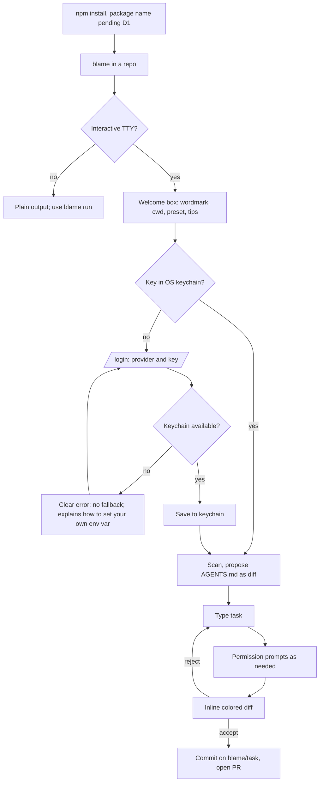
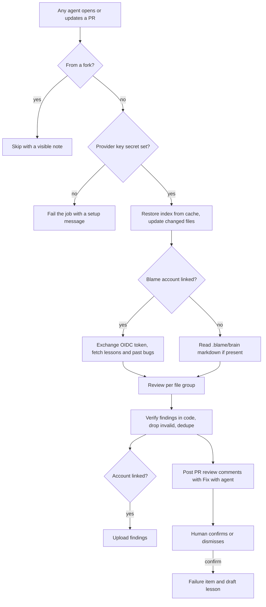
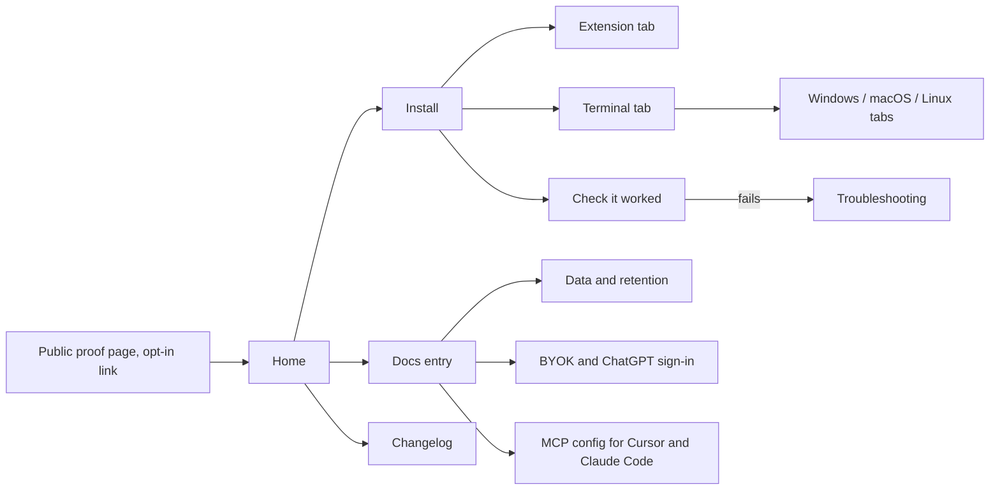

# Blame: App Flow

Where people go in Blame, what moves them forward, what happens when something fails, and where each journey ends. Covers the VS Code extension, the terminal app, the reviewer GitHub Action and the website.

| Field | Value |
|---|---|
| Version | v0.1, November 13, 2026 (Davinci, for David Bustos Jr) |
| Backbone | PRD v0.2 section 10, flows A to H |
| Calls | TRD section 5 (REST `/v1` and MCP tools) |
| Surfaces | ARCHITECTURE sections 3 to 5 |
| Layout and states | DESIGN.md |
| Status | Design-time flow. Nothing is built yet. Open decisions are marked **Pending** |

How to read it:
- Blame is local-first. The agent, keys, code index and a brain cache live on the user's machine. A Blame account (device login) is optional and only adds sync, the team brain, the GitHub App and the proof page (ARCHITECTURE 1, 8).
- "Calls" lists the endpoint or local step behind a screen. Local steps have no endpoint.
- Preset names are Manual, **Guided** and Autonomous, as in the PRD. David confirmed Guided on 2026-11-13 (TRD OQ-6, resolved).
- Every screen has default, hover, focus, active, disabled, loading, empty, error and permission-denied states (DESIGN.md). This file lists the ones that change the flow.

## 1. Shared rules every surface follows

| Rule | Source |
|---|---|
| Effective permission = min(preset ceiling, earned trust), then safe zones, then budget, then credential scope | R-AUTO-2 |
| Safe-zone actions always pause for a human, in every preset, with no override | F18, R-AUTO-3 |
| Autonomous is off until opted in per workspace, and refuses to start without the sandbox | R-AUTO-1, R-AUTO-4 |
| Preset and trust level always visible, colored by the trust ramp and labeled (never color alone) | R-AUTO-5, DESIGN.md |
| Provider, model and cost so far always visible | R-BYOK-5 |
| The agent never commits to the default branch; it works on `blame/<task>` | F9 |
| Nothing is written silently: `AGENTS.md`, lessons and diffs are proposals the user accepts | F1, F3 |
| Keys are never shown back after saving, never logged | F17 |

### The permission gate (used by every task)

Risky classes: migration, delete outside branch, secret access, egress outside the allow-list, CI change, force push (TRD 4.4). Calls: local gate; events upload later through `POST /v1/events:batch` when sync is on.

## 2. VS Code extension (Flow A)

Works in VS Code, Cursor and Windsurf (Windsurf certification after cut C7, **Pending**). Views from DESIGN.md: Chat (webview), Review findings (tree), Brain, and a status bar item.

### Primary journey

Install, then Open Blame panel, then Choose provider, then Pick preset, then Repo scan and `AGENTS.md` proposal, then First task, then Review diff, then Accept, then Draft PR on `blame/<task>`.

### Screens

**Install.** Purpose: get the extension in. Marketplace or Open VSX (Cursor and Windsurf use Open VSX). Activation registers commands only (under 1 s, R-PERF-5). Error: Node too old in the editor host and none on PATH shows an install prompt (ARCHITECTURE 4).

**Provider setup.** Purpose: connect a model the user already pays for (DEC-2).
- Inputs: provider, API key; or "Sign in with ChatGPT" (supported at launch because the client is open source, PRD DEC-8, TRD OQ-2 resolved); Anthropic is API key only, with a short note on why a Claude.ai subscription cannot be used (R-BYOK-3).
- Saves to VS Code SecretStorage. Key is masked and never shown again.
- Calls: none to Blame. A tiny test call goes from the device to the provider.
- Errors: invalid key (provider says 401), no credit or quota, provider unreachable (offline): each shows a plain message, keeps the form, offers retry. No key saved on failure.
- Empty: no key yet means Chat shows a single "Add a model key" action.
- Optional Blame account: "Sign in to sync" starts device login. Calls `POST /v1/auth/device/start`, then `POST /v1/auth/device/poll`. Skipping keeps everything local.

**Preset pick.** Manual, Guided (default), Autonomous. Autonomous is disabled with the reason until the user opts in for this workspace. Opt-in screen explains what Autonomous may do, then checks the sandbox:
- Sandbox available: preset switches on the next tool call, audit event written (FR-AUTO-2).
- Sandbox unavailable: Autonomous refuses with the reason and a fix link; preset stays where it was (R-AUTO-4).
- Windows first time: explains the one-time admin step to create the sandbox user (ADR-0005). Declining keeps Guided.

**Repo scan and `AGENTS.md` proposal (F1).** Loading: progress with file count. Result: detected test and build commands, languages, pinned versions; a diff of the proposed `AGENTS.md`. Actions: accept, edit, skip. Error: scan fails or times out, shows what was found so far and lets the user continue without it. Untrusted workspace (VS Code Restricted Mode, or a repo carrying `.pi/` or `.blame/` extensions): those extensions are not loaded until the user trusts the folder (T-17).

**Chat and first task.** Layout: header with preset toggle and trust badge; transcript; input. Before the run, context is injected.
- Calls: local brain first; `POST /v1/context` when signed in (3 s timeout). On timeout the task continues and shows "context unavailable" (FR-CORE-2).
- Bug tasks show "Reproducing first" until a failing test exists (F8).
- Approval cards follow the permission gate. Safe-zone pause names the zone and file.
- Ambiguous task: one focused question instead of a guess (F16).
- Live cost counter and budget. Budget hit: hard stop with what was done and how to continue (F15). Loop detected: stop with the repeated error shown.
- Errors: provider down or rate limited (retry, switch model), core child crashed (restarted and session resumed, ARCHITECTURE 5.1), network lost (local work continues, sync waits).
- Empty: no task yet shows two or three example tasks and the current preset.

**Diff review.** VS Code's native diff editor (DESIGN.md) with accept or reject per hunk (F23.1). Accept commits a checkpoint on `blame/<task>` and opens a draft or ready PR depending on trust (F2). PR body has summary, plan, tests, lessons applied, docs cited, cost (F9). Reject returns to Chat with the hunk marked rejected.

**Checkpoint timeline and rewind (Flow G, F10).** List of checkpoints with time and summary. Preview shows the diff, restore asks first if the user has uncommitted work. Empty: "No checkpoints yet."

**Review findings (Flow E, F24).** Tree view grouped by PR, then file and line, each with severity (icon plus label, never color alone).
- "Send to agent" (the "Fix with agent" link in PR comments opens the same flow through `vscode://<publisher>.blame/fix?finding=<id>`): Chat opens with path, line range and finding preloaded. Calls: `get_review_finding` or `GET /v1/reviews`.
- Confirm or dismiss a finding: `PATCH /v1/findings/{id}`. Confirm creates a draft lesson for approval (Flow C).
- Empty: "No reviews yet" with a link to set up the reviewer Action (section 4).
- Error: finding no longer matches the code (file moved), shows the original excerpt and asks before guessing.

**Brain view (F6, F3).** What Blame knows about this repo: lessons with proof status (Active, Proven, Regressed), decisions, failures, each with its source link. The never-repeated chart with its denominator (PRD 13.2).
- Calls: local store; `GET /v1/brain/search`, `GET /v1/metrics/never-repeated` when signed in.
- Draft lesson card: approve, edit, merge with suggested duplicate (`409` merge candidates from `POST /v1/knowledge-items`), discard.
- Stale items show a "needs review" flag and are not auto-injected.
- Empty (new repo): explains that lessons appear after the first failure, with nothing invented.
- Export: writes markdown and `AGENTS.md` (`GET /v1/export` or local `blame export`).

**Status bar.** Shows preset and trust level, for example "Guided · L1" colored by the ramp. Click opens the preset picker. Tooltip shows provider, model and session cost.

**Revoke (Flow H, F5).** Command palette "Blame: Revoke". Confirm screen lists every credential. Calls `POST /v1/agents/{id}/revoke`. Result lists each credential as revoked, requested or expires at, with times. ChatGPT session revoke may be deferred (cut C8, **Pending**); then the UI says to sign out in ChatGPT settings.

## 3. Terminal app (Flow B)

Built on Pi's interactive mode with Blame's theme (ADR-0002). Layout from DESIGN.md: welcome box, transcript, inline diffs, working indicator, bordered input, footer.

### Primary journey

Install with one command, then `blame` in a repo, then Welcome box, then Provider setup, then Preset, then Scan and `AGENTS.md` proposal, then Task, then Diff, then Accept, then PR.

### Screens and interactions

**Welcome box (first run).** Rounded border, wordmark in accent, working directory, current preset, two or three tips in muted text. Not a git repo: says so and offers to continue read-only or exit.

**Provider setup.** `/login` or first-run prompt. Same rules as the extension, stored in the OS keychain (FR-KEY-1). Keychain missing or locked (on Linux, no Secret Service): a clear error with no fallback to a file or env var; the error explains how to set your own env var. No plaintext file store (TRD OQ-7). Anthropic OAuth login is not offered (FR-KEY-4). Invalid key or provider unreachable: message in the transcript, prompt stays, retry.

**Preset cycling.** shift+tab cycles Manual, Guided, Autonomous; `/mode` does the same by name. Autonomous is skipped until opted in for this workspace; trying `/mode autonomous` before opt-in starts the opt-in explanation. Sandbox unavailable: refuses with the reason, preset unchanged. Footer shows the preset on the left in its trust color with the level label, key hints on the right.

**Transcript and tool calls.** User turns prefixed with `>`. Tool calls on their own line with an accent bullet, tool name in bold, args muted; results indented and collapsed after a few lines with a "show more" hint. Diffs inline with tinted backgrounds.

**Permission prompt.** Bordered box with the exact command or file and numbered choices: allow once, allow for this session, deny. Enter picks the highlighted one. Safe-zone prompts never offer "allow for this session" beyond the single action (**Pending** confirmation with Forge; PRD only requires a human every time). Deny: the agent stops or asks.

**Working and interrupt.** Spinner in accent, status word, elapsed time, "esc to interrupt". Esc stops the current step, keeps the transcript and the last checkpoint, and returns to the input.

**Slash commands (F23.2).** `/model` (switch model, shows cost), `/mode` (preset), `/rewind` (checkpoint list, preview, restore; asks before touching uncommitted work), `/lessons` (proof list and chart in text), `/review` (runs the reviewer locally on the current branch, FR-REV-4). Unknown command: suggestion list, nothing runs.

**Fallbacks.** `NO_COLOR` or a non-TTY gives plain text. Color falls back truecolor, then ANSI 256, then ANSI 16. Glyphs fall back to ASCII. Works at 80 columns.

**Errors.** Provider down or rate limited: message, retry, `/model` to switch. Offline: local brain still injects, sync waits. Budget hit or loop detected: hard stop with summary.

**Non-interactive `blame run`.** `blame run "task" --json` streams JSONL events for scripts and CI. The flag is `--mode`, for example `--mode guided` (PRD DEC-11). "Preset" stays the name for the setting itself. Never prompts: any action that needs approval ends the run with a non-zero exit and an event naming the action. Autonomous without opt-in or without sandbox exits with an error before any tool call.

**Other commands.** `blame lessons`, `blame export`, `blame revoke`, `blame fix <finding-id>` (opens a session with the finding preloaded), `blame mcp` (stdio MCP server for Cursor and Claude Code, Flow F), `blame init review` (writes the reviewer workflow, section 4).

## 4. Reviewer GitHub Action on an agent PR (Flow E)

Runs in the user's repo with the user's key (ADR-0004, **Pending** David's confirmation). Thin version first, full cross-file version later (cut C6).

### Setup

`blame init review` writes `.github/workflows/blame-review.yml` and tells the user which Actions secret to add for their provider key. The website has the same two-minute steps. Workflow permissions: `contents: read`, `pull-requests: write`, `id-token: write`; never `pull_request_target`.

### Run

Calls: `POST /v1/auth/actions-oidc`, `POST /v1/reviews`, `POST /v1/reviews/{id}/findings`; comments with `GITHUB_TOKEN`.

States and branches:
- Cache evicted: full index rebuild, slower but same result.
- Provider error or timeout: job fails with the provider's message; no partial comments.
- No findings: one short "no issues found" review, so the user knows it ran.
- Confirm: maintainer reacts, replies `/blame confirm`, or the fix commit referencing the finding merges (exact reaction **Pending**, REVIEWER_AND_BRAIN 7). Dismiss: `PATCH /v1/findings/{id}`.
- "Fix with agent" choices on each comment: extension link, `blame fix <id>`, or a copy-ready prompt for Cursor or Claude Code (also via MCP `get_review_finding`).
- Comments appear as `github-actions[bot]` until a branded GitHub App identity exists.

## 5. Website (`apps/web`)

Pages from DESIGN.md: home, install, docs entry, changelog. PRD F23.3 also requires a data and retention page, a BYOK and ChatGPT sign-in explanation, MCP config snippets, and an opt-in public proof page. Install, BYOK and data pages come first (IMPLEMENTATION_PLAN Phase 8a); the proof page follows the brain work (Phase 8b).

**Home.** Nav (wordmark, Docs, Changelog, GitHub, Install button), hero with one headline, two install buttons and a terminal block in brand ANSI colors, the trust ramp band, proof sections per pillar using real captures, repeated install block, footer.

**Install.** Tabs for extension and terminal, OS tabs for Windows, macOS and Linux. Copy buttons confirm "Copied". A "check it worked" step, then troubleshooting (Node version, keychain missing on Linux, Windows sandbox admin step, Open VSX for Cursor and Windsurf).

**Docs entry.** Links to the data page, BYOK and ChatGPT sign-in, why Claude subscriptions cannot be used, MCP snippets, reviewer setup.

**Changelog.** Newest first. Empty before launch: "First release coming soon", no fake entries.

**Proof page (opt-in).** A project's never-repeated chart with its denominator and evidence links. Not shared or never shared: safe not-found page, no data leaked. Unpublished: link stops working.

States: works at 375, 768 and 1440; keyboard reachable with visible focus; `prefers-reduced-motion` respected; a failed API call on the proof page shows a plain error, never a stack trace.

## 6. Secondary flows

| Flow | Path | Calls |
|---|---|---|
| Returning user | Open panel or `blame`; preset, trust and last session restored; brain cache refreshed in the background | `POST /v1/context` |
| Failure to lesson (Flow C) | Revert, failing test, changes requested, denied approval, confirmed finding or "that was wrong" becomes a Draft failure; next session drafts a lesson and regression test; user confirms; test lands by PR | `POST /v1/failures`, `POST /v1/knowledge-items`, `POST /v1/lessons/{id}/events` |
| Companion (Flow F) | Copy MCP snippet from website, run `blame mcp`, agent calls `get_context`; `check_action` is advisory only | MCP tools, TRD 5.2 |
| Safe zones | Settings list of patterns with reasons; add or remove asks to confirm | `GET/POST/DELETE /v1/repos/{id}/safe-zones` |
| Audit export | `blame` CLI export as JSONL | `GET /v1/events?format=jsonl` |
| Disconnect repo | Explains that index data is purged within 24 hours; confirm | `DELETE /v1/repos/{id}` |
| Delete account | Explains impact (all tenant data, backups within 30 days), re-authenticate, confirm | `DELETE /v1/orgs/{id}` |
| Sign out | Revokes the refresh token | `POST /v1/auth/logout` |

## 7. Important states

| State | What the user sees |
|---|---|
| Loading | Spinner with a status word and elapsed time; never a frozen panel |
| Empty | One sentence on what will appear and the action that makes it appear |
| Missing or invalid key | Setup prompt with the provider's reason; key never echoed |
| Offline or provider down | Plain message, retry, switch model; local brain still works |
| Context unavailable | Task continues; a muted note says lessons were not injected |
| Sandbox unavailable | Autonomous refuses with the reason; other presets keep working with their profiles |
| Permission denied | Agent stops or asks; audit event recorded |
| Safe-zone pause | Approval prompt naming the zone and file, every time |
| Budget or loop stop | Hard stop with what was done and how to continue |
| Stale lesson | "Needs review" flag; not auto-injected |
| Regressed lesson | Shown in the chart, linked to the new failure; never hidden |

## 8. Screen checklist and gaps

Each screen above must define purpose, required content, primary action, secondary action, loading, empty and error states before it is built. Gaps found while writing this:

- DESIGN.md's website page list does not yet include the data page, the BYOK explanation or the proof page that PRD F23.3 requires.
- PRD F23.1 asks for per-hunk accept or reject; DESIGN.md says use VS Code's native diff editor. This doc assumes per-hunk actions on top of the native diff editor; Forge to confirm it is feasible.
- Whether a safe-zone approval can ever be "for this session" is not specified; this doc assumes one approval per action.
- The confirm reaction on GitHub review comments is open (REVIEWER_AND_BRAIN 7).
- Account sign-in UI on the website (session cookie, TRD 5.1) has no page in DESIGN.md yet.
