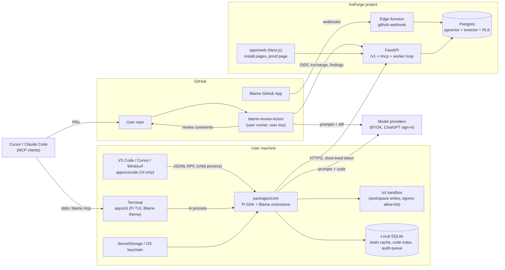
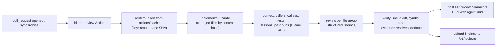

# Blame: Architecture

Version v0.1, November 13, 2026. Owner: Forge. Requirements and reasoning live in [TRD.md](TRD.md) and [adr/](adr/); this file describes how the pieces connect. Update it whenever the structure changes.

## 1. System overview

Blame is local-first. The agent, the code index and the provider keys live on the user's machine. The reviewer runs in the user's own GitHub Actions. The cloud holds only the shared learning record (lessons, knowledge items, links, findings, audit events) plus the GitHub App plumbing.



| External service | What it does for Blame |
|---|---|
| Model providers (through Pi's `pi-ai`) | All inference. Called only from the device or the user's Action |
| GitHub App | Webhooks for failure capture (reverts, unmerged closes, changes requested, CI failures); installation binding |
| GitHub Actions | Runs the reviewer and CI. OIDC tokens let the Action authenticate to Blame without a stored secret ([GitHub OIDC docs](https://docs.github.com/en/actions/concepts/security/openid-connect)) |
| InsForge | Postgres, edge function, one custom compute container, website hosting |
| Context7 | Docs-first lookups from the device |

## 2. Tech stack summary

TypeScript on Node 22.19+ for every client package, Pi 1.5.x as the engine, `pi-tui` for the terminal, VS Code API plus React webviews for the extension, Python FastAPI for the API, Postgres with pgvector on InsForge, Next.js for the website, GitHub Actions for CI and review. Reasoning: [TRD section 3](TRD.md#3-tech-stack).

## 3. Project structure

```
blame/
  packages/
    core/            Only package that imports Pi. Session factory, Blame extensions, policy, brain client, index, sandbox adapter
      src/session/       createBlameSession(), RPC server entry for the extension
      src/extensions/    context-inject, autonomy-gate, audit, checkpoints, guardrails, redact, reproduce-first, docs-first
      src/policy/        trust levels, presets, safe zones, risky-action classifier (data driven)
      src/brain/         BrainStore interface; LocalBrainStore (SQLite) and RemoteBrainStore (REST)
      src/index/         code index: tree-sitter symbols, import graph, chunks, embeddings
      src/review/        reviewer pipeline shared by `blame review` and the Action
      src/sandbox/       srt adapter, profiles per preset
      src/keys/          CredentialStore implementations (keychain, SecretStorage bridge)
    api-client/      TypeScript client generated from apps/api/openapi.json
    design-tokens/   Tokens from DESIGN.md for every surface: ANSI palette (truecolor, 256, 16, NO_COLOR), CSS variables, later the Pi theme JSON
  apps/
    cli/             `blame` binary: Pi interactive mode branded via piConfig + Blame extensions; subcommands
    vscode/          Extension host code (thin) + webviews (React); spawns core as a child process
    web/             Next.js site: install, data page, proof page, thin dashboard later
    api/             FastAPI app, worker loop, MCP HTTP endpoint, migrations runner
    review-action/   GitHub Action wrapper (node24 action) around packages/core/src/review
  functions/
    github-webhook/  InsForge edge function (Deno)
  db/migrations/     Plain SQL, applied with the InsForge CLI
  evals/             seeded bug tasks, retrieval golden set, planted-bug benchmark, injection cases
  docs/              PRD, TRD, ARCHITECTURE, ADRs, threat model, plans
```

`apps/api`, `apps/review-action`, `packages/api-client`, `packages/design-tokens`, `functions/` and `db/` are additions to the planned layout in PRD DEC-3.

## 4. How core embeds Pi, and how CLI and extension share it

Verified against the Pi repo at commit `827383a` (Nov 13, 2026, packages at 1.5.2).

Pi offers three integration surfaces ([SDK](https://github.com/earendil-works/pi/blob/main/packages/coding-agent/docs/sdk.md), [RPC](https://github.com/earendil-works/pi/blob/main/packages/coding-agent/docs/rpc.md), [extensions](https://github.com/earendil-works/pi/blob/main/packages/coding-agent/docs/extensions.md)):

- **SDK.** `createAgentSession()` from `@earendil-works/pi-coding-agent` gives an in-process `AgentSession` with `prompt()`, `steer()`, `followUp()`, `abort()`, `subscribe()`. Every boundary can be replaced: `modelRuntime`, `settingsManager`, `sessionManager`, `resourceLoader` (inline extension factories), tools.
- **RPC.** `pi --mode rpc` speaks strict JSONL over stdin and stdout; the package exports `RpcClient` and a `./rpc-entry` export. Extension UI requests (confirm, select, input) are forwarded to the client as `extension_ui_request` records.
- **Extensions.** Event hooks including `before_agent_start` (inject a message or patch system prompt sections), `tool_call` (mutate input or return `{block, reason}`), `tool_result`, `turn_start`, `session_start`, plus `pi.registerTool()` and `ctx.ui.*` dialogs.

Blame's use:

1. `packages/core` exposes `createBlameSession({cwd, preset, brain, keys, sandbox})`. It calls `createAgentSession()` with a `DefaultResourceLoader` whose inline extension factories are Blame's extensions, a `ModelRuntime` backed by Blame's `CredentialStore` (so Pi never writes `auth.json`), and `SessionManager` storage under Blame's config dir.
2. **CLI** runs core in process and reuses Pi's interactive mode for the TUI, branded through `piConfig` (`name: "blame"`, `configDir: ".blame"`, read from the starting package's `package.json` in `packages/coding-agent/src/config.ts`) and Blame's theme and UI extensions ([ADR-0002](adr/0002-terminal-ui-framework.md)).
3. **Extension** spawns core as a child process (`node dist/rpc.js`) and talks to it with Pi's RPC records plus a few Blame-specific records (`blame_state`, `blame_approval`, `blame_checkpoints`). Reasons: a runaway agent never blocks the extension host; the whole agent process can sit inside the `srt` sandbox; and the child can use a newer Node than an editor fork ships (OQ-5). The child is launched with the editor's own Node (`process.execPath` with `ELECTRON_RUN_AS_NODE=1`) when its version is 22.19+, otherwise with a Node found on PATH, otherwise the extension shows a clear install prompt.
4. Pi version is pinned exactly; Blame code imports Pi only inside `packages/core` (TG-1), so an upgrade or fork touches one package.

Hooks Blame installs:

| Pi hook | Blame extension | Behavior |
|---|---|---|
| `session_start` | context-inject | Load repo profile, AGENTS.md, safe zones, current preset and trust |
| `before_agent_start` | context-inject | `getContext(task, paths)` from the brain, injected as one labeled custom message with source links; records "lesson applied" events |
| `tool_call` | autonomy-gate | Classify action, evaluate policy (TRD 4.4), `ctx.ui.confirm` for ask, `{block:true}` for deny; audit event either way |
| `tool_call` (bash) | sandbox | Rewrite command to run through `srt` when the session is not already fully sandboxed |
| `tool_result` | redact | Strip secrets before results reach model context or logs |
| `turn_start`, `agent_end` | checkpoints | Checkpoint commit or ref; loop detector; budget check |
| registered tools | brain tools | `search_brain`, `record_failure`, `propose_lesson`, `run_reproduction` |

## 5. Data flow

### 5.1 A task in the extension

1. User types a task in the chat webview; webview posts a message to the extension host.
2. Extension host forwards it as an RPC `prompt` to the core child process.
3. Core `before_agent_start` fetches context (local cache first, refreshed from `POST /v1/context` when signed in, 3 s timeout).
4. Pi streams model output; tool calls hit the autonomy gate. "Ask" decisions become `extension_ui_request` records shown as approval cards.
5. Tool execution happens inside the sandbox; results pass through redaction.
6. Checkpoints and audit events are written to local SQLite, then uploaded in batches (`POST /v1/events:batch`) when sync is on.
7. Diffs stream back to the webview for per-hunk accept or reject. Errors and loading states are shown per step; a lost child process is restarted and the session resumed from Pi's session file.

### Per-hunk accept and reject in the extension (F23.1)

PRD F23.1 requires accept or reject per hunk, and that works alongside the native diff editor. As of 13 November 2026, the stable VS Code API ([vscode-api](https://code.visualstudio.com/api/references/vscode-api)) has no method that accepts or rejects an individual hunk inside the native diff editor. The built-in `vscode.diff` command ([built-in commands](https://code.visualstudio.com/api/references/commands)) is used only to open a side-by-side view of the original file and the proposed change.

Per-hunk Accept and Reject are provided on Blame's proposed-change view, using a `CodeLensProvider` and/or editor decorations (`window.createTextEditorDecorationType` and `TextEditor.setDecorations`) on the proposed document. Accepting or rejecting a hunk applies the decision with a `WorkspaceEdit` through `workspace.applyEdit`.

Proposed APIs that attach actions to the native diff editor, including `commands.registerDiffInformationCommand` (proposed `diffCommand`; see [vscode#84899](https://github.com/microsoft/vscode/issues/84899)) and the `contribDiffEditorGutterToolBarMenus` / `diffEditor/gutter/hunk` menu, are not stable and must not be used for Marketplace or Open VSX publishing (FR-EXT-3).

### 5.2 Failure capture

1. GitHub sends a webhook (for example a revert PR merged) to the edge function.
2. The function verifies `X-Hub-Signature-256` on the raw body, inserts `webhook_deliveries(delivery_id)` (conflict means duplicate, return 200), inserts a `jobs` row, returns 200.
3. The FastAPI worker loop claims jobs with `FOR UPDATE SKIP LOCKED`, sets tenant context from the installation binding, writes a Draft failure item with evidence excerpts and SHA.
4. Lesson drafting needs a model, so it runs on the next client session (the user's device drafts it with the user's key and shows it for approval) or in the next Action run. The server never calls a model in the MVP.

### 5.3 Review

See [ADR-0004](adr/0004-reviewer-runtime.md) and [REVIEWER_AND_BRAIN.md](REVIEWER_AND_BRAIN.md). Summary: `pull_request` event starts the Action in the user's repo, the Action restores the code index from cache and updates it incrementally, exchanges its OIDC token for a 10-minute Blame token, pulls lessons and past bugs, reviews, posts comments with `GITHUB_TOKEN`, and uploads findings.

## 6. Database and storage

Postgres 15+ on InsForge. Every tenant table has `org_id`, a composite unique key `(org_id, id)`, and child tables reference parents through `(org_id, parent_id)` so a row can never point at another tenant's parent. RLS is enabled and forced on all tenant tables.

```sql
CREATE EXTENSION IF NOT EXISTS pgcrypto;
CREATE EXTENSION IF NOT EXISTS vector;

-- Tenant context: set per transaction by the API after it checks membership
CREATE FUNCTION app_org() RETURNS uuid LANGUAGE sql STABLE AS
$$ SELECT nullif(current_setting('app.org_id', true), '')::uuid $$;

CREATE TABLE organizations (id uuid PRIMARY KEY DEFAULT gen_random_uuid(), name text NOT NULL,
  slug text NOT NULL UNIQUE, trust_policy jsonb NOT NULL DEFAULT '{}', created_at timestamptz NOT NULL DEFAULT now());
CREATE TABLE users (id uuid PRIMARY KEY DEFAULT gen_random_uuid(), github_id bigint UNIQUE, email text UNIQUE,
  name text, created_at timestamptz NOT NULL DEFAULT now());
CREATE TABLE memberships (org_id uuid NOT NULL REFERENCES organizations(id) ON DELETE CASCADE,
  user_id uuid NOT NULL REFERENCES users(id) ON DELETE CASCADE,
  role text NOT NULL CHECK (role IN ('owner','admin','member','viewer')), PRIMARY KEY (org_id, user_id));

-- GitHub binding: an installation belongs to exactly one org, bound server-side via signed state
CREATE TABLE github_installations (installation_id bigint PRIMARY KEY,
  org_id uuid NOT NULL REFERENCES organizations(id) ON DELETE CASCADE, account_login text NOT NULL,
  suspended_at timestamptz, created_at timestamptz NOT NULL DEFAULT now(), UNIQUE (org_id, installation_id));
CREATE TABLE repositories (id uuid NOT NULL DEFAULT gen_random_uuid(), org_id uuid NOT NULL,
  installation_id bigint NOT NULL, github_repo_id bigint NOT NULL, full_name text NOT NULL,
  default_branch text NOT NULL DEFAULT 'main', profile jsonb NOT NULL DEFAULT '{}',
  created_at timestamptz NOT NULL DEFAULT now(),
  PRIMARY KEY (id), UNIQUE (org_id, id), UNIQUE (org_id, github_repo_id),   -- unique per org, not global
  FOREIGN KEY (org_id, installation_id) REFERENCES github_installations(org_id, installation_id) ON DELETE CASCADE);

-- Autonomy as data (global reference tables, read-only to the app role)
CREATE TABLE trust_levels (level smallint PRIMARY KEY, name text NOT NULL, description text NOT NULL,
  capabilities text[] NOT NULL, ramp_token text NOT NULL);           -- e.g. 'trust.l2', resolved by DESIGN.md tokens
CREATE TABLE autonomy_presets (id text PRIMARY KEY, label text NOT NULL, sort smallint NOT NULL,
  ceiling_level smallint NOT NULL REFERENCES trust_levels(level), policy jsonb NOT NULL,   -- auto_allow, ask, sandbox_profile
  requires_opt_in boolean NOT NULL DEFAULT false);

CREATE TABLE agents (id uuid NOT NULL DEFAULT gen_random_uuid(), org_id uuid NOT NULL REFERENCES organizations(id) ON DELETE CASCADE,
  name text NOT NULL, vendor text NOT NULL CHECK (vendor IN ('blame','cursor','claude_code','codex','other')),
  status text NOT NULL DEFAULT 'active' CHECK (status IN ('active','paused','offboarded')),
  created_at timestamptz NOT NULL DEFAULT now(), PRIMARY KEY (id), UNIQUE (org_id, id));
CREATE TABLE agent_trust (org_id uuid NOT NULL, agent_id uuid NOT NULL, repo_id uuid NOT NULL,
  task_class text NOT NULL DEFAULT '*', level smallint NOT NULL REFERENCES trust_levels(level),
  updated_at timestamptz NOT NULL DEFAULT now(), PRIMARY KEY (org_id, agent_id, repo_id, task_class),
  FOREIGN KEY (org_id, agent_id) REFERENCES agents(org_id, id) ON DELETE CASCADE,
  FOREIGN KEY (org_id, repo_id) REFERENCES repositories(org_id, id) ON DELETE CASCADE);
CREATE TABLE trust_events (id bigserial PRIMARY KEY, org_id uuid NOT NULL, agent_id uuid NOT NULL, repo_id uuid NOT NULL,
  task_class text NOT NULL, from_level smallint, to_level smallint NOT NULL, reason text NOT NULL, evidence_ref text,
  created_at timestamptz NOT NULL DEFAULT now(), FOREIGN KEY (org_id, agent_id) REFERENCES agents(org_id, id));

-- Credentials Blame issues (hashed) and the rare secrets it holds (envelope-encrypted)
CREATE TABLE api_tokens (id uuid NOT NULL DEFAULT gen_random_uuid(), org_id uuid NOT NULL, user_id uuid REFERENCES users(id),
  agent_id uuid, kind text NOT NULL CHECK (kind IN ('access','refresh','mcp','action')), scopes text[] NOT NULL,
  repo_ids uuid[] NOT NULL DEFAULT '{}', token_hash bytea NOT NULL UNIQUE, family_id uuid,   -- refresh rotation family
  expires_at timestamptz NOT NULL, revoked_at timestamptz, last_used_at timestamptz,
  PRIMARY KEY (id), UNIQUE (org_id, id), FOREIGN KEY (org_id, agent_id) REFERENCES agents(org_id, id) ON DELETE CASCADE);
CREATE TABLE tenant_keys (org_id uuid PRIMARY KEY REFERENCES organizations(id) ON DELETE CASCADE,
  wrapped_dek bytea NOT NULL, kek_id text NOT NULL, rotated_at timestamptz NOT NULL DEFAULT now());
CREATE TABLE provider_secrets (id uuid NOT NULL DEFAULT gen_random_uuid(), org_id uuid NOT NULL, provider text NOT NULL,
  ciphertext bytea NOT NULL, nonce bytea NOT NULL, created_by uuid REFERENCES users(id), revoked_at timestamptz,
  PRIMARY KEY (id), UNIQUE (org_id, id), FOREIGN KEY (org_id) REFERENCES tenant_keys(org_id));  -- unused until hosted reviewer opt-in

-- Second brain (Cortex's design). Lessons and failures are knowledge items.
CREATE TABLE knowledge_items (id uuid NOT NULL DEFAULT gen_random_uuid(), org_id uuid NOT NULL, repo_id uuid,
  kind text NOT NULL CHECK (kind IN ('lesson','failure','decision','fix','incident','skill')),
  title text NOT NULL, body text NOT NULL, source_quote text NOT NULL, source_url text NOT NULL,
  status text NOT NULL DEFAULT 'draft' CHECK (status IN ('draft','confirmed','superseded')),
  proof_status text CHECK (proof_status IN ('active','proven','regressed')),
  scope_paths text[] NOT NULL DEFAULT '{}', fingerprint text, details jsonb NOT NULL DEFAULT '{}',
  stale boolean NOT NULL DEFAULT false, stale_reason text,
  embed_model text, embedding vector(1536),   -- dimension fixed by the chosen model (TRD OQ-1); 1536 is a placeholder
  tsv tsvector GENERATED ALWAYS AS (to_tsvector('english', title || ' ' || body)) STORED,
  confirmed_by uuid REFERENCES users(id), created_at timestamptz NOT NULL DEFAULT now(), updated_at timestamptz NOT NULL DEFAULT now(),
  PRIMARY KEY (id), UNIQUE (org_id, id),
  FOREIGN KEY (org_id, repo_id) REFERENCES repositories(org_id, id) ON DELETE CASCADE,
  CHECK (proof_status IS NULL OR (kind = 'lesson' AND status = 'confirmed')));
CREATE INDEX ki_scope ON knowledge_items (org_id, repo_id, kind, status);
CREATE INDEX ki_tsv ON knowledge_items USING gin (tsv);
CREATE INDEX ki_vec ON knowledge_items USING hnsw (embedding vector_cosine_ops);

CREATE TABLE links (id uuid NOT NULL DEFAULT gen_random_uuid(), org_id uuid NOT NULL, from_id uuid NOT NULL,
  to_id uuid, to_ref text,   -- to_ref for external targets: 'pr:42', 'commit:<sha>', 'file:src/a.ts', 'finding:<uuid>', 'agent:<uuid>'
  relation text NOT NULL CHECK (relation IN ('caused_by','fixes','supersedes','applies_to','evidence_of','found_by')),
  created_at timestamptz NOT NULL DEFAULT now(), PRIMARY KEY (id),
  FOREIGN KEY (org_id, from_id) REFERENCES knowledge_items(org_id, id) ON DELETE CASCADE,
  FOREIGN KEY (org_id, to_id) REFERENCES knowledge_items(org_id, id) ON DELETE CASCADE,
  CHECK ((to_id IS NULL) <> (to_ref IS NULL)));
CREATE TABLE knowledge_anchors (org_id uuid NOT NULL, item_id uuid NOT NULL, path text NOT NULL, commit_sha text NOT NULL,
  content_hash text NOT NULL, PRIMARY KEY (org_id, item_id, path),
  FOREIGN KEY (org_id, item_id) REFERENCES knowledge_items(org_id, id) ON DELETE CASCADE);

-- Proof record
CREATE TABLE regression_tests (id uuid NOT NULL DEFAULT gen_random_uuid(), org_id uuid NOT NULL, lesson_id uuid NOT NULL,
  path text NOT NULL, test_name text NOT NULL, pr_number int, merged_sha text, last_result text CHECK (last_result IN ('pass','fail')),
  last_run_sha text, last_run_url text, PRIMARY KEY (id),
  FOREIGN KEY (org_id, lesson_id) REFERENCES knowledge_items(org_id, id) ON DELETE CASCADE);
CREATE TABLE lesson_events (id bigserial PRIMARY KEY, org_id uuid NOT NULL, lesson_id uuid NOT NULL,
  event text NOT NULL CHECK (event IN ('exposed','applied','avoided','recurred')), task_ref text NOT NULL,
  agent_vendor text NOT NULL, head_sha text NOT NULL, evidence_ref text NOT NULL, created_at timestamptz NOT NULL DEFAULT now(),
  UNIQUE (org_id, lesson_id, event, task_ref),
  FOREIGN KEY (org_id, lesson_id) REFERENCES knowledge_items(org_id, id) ON DELETE CASCADE);

-- Reviewer (F24)
CREATE TABLE review_runs (id uuid NOT NULL DEFAULT gen_random_uuid(), org_id uuid NOT NULL, repo_id uuid NOT NULL,
  pr_number int NOT NULL, head_sha text NOT NULL, base_sha text NOT NULL,
  runner text NOT NULL CHECK (runner IN ('action','local','worker')), model text NOT NULL,
  status text NOT NULL DEFAULT 'running' CHECK (status IN ('running','done','failed')), cost_usd numeric(10,4),
  started_at timestamptz NOT NULL DEFAULT now(), finished_at timestamptz,
  PRIMARY KEY (id), UNIQUE (org_id, id), UNIQUE (org_id, repo_id, pr_number, head_sha, runner),
  FOREIGN KEY (org_id, repo_id) REFERENCES repositories(org_id, id) ON DELETE CASCADE);
CREATE TABLE review_findings (id uuid NOT NULL DEFAULT gen_random_uuid(), org_id uuid NOT NULL, review_id uuid NOT NULL,
  path text NOT NULL, start_line int NOT NULL, end_line int NOT NULL, severity text NOT NULL CHECK (severity IN ('high','medium','low')),
  category text NOT NULL, title text NOT NULL, body text NOT NULL, evidence jsonb NOT NULL, confidence real NOT NULL,
  status text NOT NULL DEFAULT 'open' CHECK (status IN ('open','confirmed','dismissed','fixed')),
  github_comment_id bigint, failure_item_id uuid, PRIMARY KEY (id), UNIQUE (org_id, id),
  FOREIGN KEY (org_id, review_id) REFERENCES review_runs(org_id, id) ON DELETE CASCADE,
  FOREIGN KEY (org_id, failure_item_id) REFERENCES knowledge_items(org_id, id));

-- Guardrails and audit
CREATE TABLE safe_zones (id uuid NOT NULL DEFAULT gen_random_uuid(), org_id uuid NOT NULL, repo_id uuid NOT NULL,
  pattern text NOT NULL, reason text, created_by uuid REFERENCES users(id), PRIMARY KEY (id), UNIQUE (org_id, repo_id, pattern),
  FOREIGN KEY (org_id, repo_id) REFERENCES repositories(org_id, id) ON DELETE CASCADE);
CREATE TABLE events (id bigserial PRIMARY KEY, org_id uuid NOT NULL, repo_id uuid, agent_id uuid, session_ref text,
  client_event_id uuid NOT NULL, kind text NOT NULL, tool text, target text, decision text, risk text,
  preset text, trust_level smallint, cost_usd numeric(10,6) NOT NULL DEFAULT 0, payload jsonb NOT NULL DEFAULT '{}',
  created_at timestamptz NOT NULL DEFAULT now(), UNIQUE (org_id, client_event_id));
CREATE INDEX events_org_time ON events (org_id, created_at DESC);

-- Plumbing (service role only, no tenant RLS needed beyond grants)
CREATE TABLE webhook_deliveries (delivery_id uuid PRIMARY KEY, event text NOT NULL, installation_id bigint,
  received_at timestamptz NOT NULL DEFAULT now(), status text NOT NULL DEFAULT 'queued');
CREATE TABLE jobs (id bigserial PRIMARY KEY, org_id uuid, kind text NOT NULL, payload jsonb NOT NULL,
  idempotency_key text UNIQUE, run_after timestamptz NOT NULL DEFAULT now(), attempts int NOT NULL DEFAULT 0,
  locked_at timestamptz, last_error text);

-- RLS pattern, applied to every tenant table in a migration loop
ALTER TABLE knowledge_items ENABLE ROW LEVEL SECURITY;
ALTER TABLE knowledge_items FORCE ROW LEVEL SECURITY;
CREATE POLICY tenant_isolation ON knowledge_items
  USING (org_id = app_org()) WITH CHECK (org_id = app_org());
-- events: INSERT and SELECT only for the app role (append-only); UPDATE and DELETE revoked.
```

Access rules:

- The FastAPI app connects as `blame_app`, which owns nothing, has RLS forced, and runs `SET LOCAL app.org_id = $1` in every transaction after checking membership from the token. A missing setting means `app_org()` is null and every policy returns zero rows (fail closed).
- The worker uses the same role and sets tenant context from `github_installations` for each job.
- Migrations run as the owner role from CI only.
- InsForge's auto REST endpoints are not used for tenant tables in the MVP (all access goes through FastAPI), so policies do not depend on InsForge JWT claims. If that changes, policies get a second clause for the JWT org claim.
- No file storage in the MVP. Evidence is text excerpts in Postgres.

Local storage on the device (`~/.blame/<repo-hash>/blame.db`, `node:sqlite`): `brain_items` (mirror of Confirmed items with FTS5 and embedding blobs), `code_chunks`, `symbols`, `imports`, `audit_queue`, `checkpoints`. Schema mirrors the cloud columns needed for ranking. See [ADR-0003](adr/0003-index-and-retrieval-storage.md).

## 7. The reviewer and index pipeline

Detail in [REVIEWER_AND_BRAIN.md](REVIEWER_AND_BRAIN.md). Where it runs: [ADR-0004](adr/0004-reviewer-runtime.md).



## 8. The brain

Two stores behind one `BrainStore` interface in core:

- `LocalBrainStore`: SQLite, works with no account (solo free use), used as a cache when signed in.
- `RemoteBrainStore`: REST to FastAPI, the source of truth for teams and for the reviewer Action.

Hybrid retrieval in both: full-text (Postgres `tsvector` or SQLite FTS5) plus vector cosine, fused with reciprocal rank fusion, then path-match boost for items whose `scope_paths` match the task's paths. Writes go through dedupe. Detail and evals: [REVIEWER_AND_BRAIN.md](REVIEWER_AND_BRAIN.md).

## 9. Sandboxing

| Where | Mechanism | What it enforces |
|---|---|---|
| Device, Guided preset | `srt` wraps each bash tool call | Writes only in the workspace (plus temp); egress only through the `srt` proxy to the allow-list (model provider, docs hosts) |
| Device, Autonomous preset | Whole core child process launched under `srt` | Same, plus package registries on the allow-list, CPU, memory and wall-clock limits. If `srt` is unavailable the preset refuses to start (R-AUTO-4) |
| Device, Manual preset | `srt` read-only profile | No writes until approved |
| Reviewer | GitHub-hosted runner, fresh per job ([GitHub docs](https://docs.github.com/en/actions/concepts/runners/github-hosted-runners)) | The reviewer only reads code and calls a model; it never executes repo code in the MVP |
| Hosted sandbox | Deferred (PRD cut C4) | Container or microVM per task, later |

Pi also documents a Gondolin micro-VM extension and plain Docker as isolation options ([containerization](https://github.com/earendil-works/pi/blob/main/packages/coding-agent/docs/containerization.md)); they are fallbacks if `srt` fails a platform. See [ADR-0005](adr/0005-local-sandbox.md).

## 10. Auth, BYOK and key storage

- Provider keys: extension stores them in `context.secrets` ([VS Code SecretStorage](https://code.visualstudio.com/api/references/vscode-api#SecretStorage)) and passes them to the core child over the RPC pipe at session start, held in memory only. CLI stores them in the OS keychain (`@napi-rs/keyring`: macOS Keychain, Windows Credential Manager, Linux Secret Service). Core implements Pi's `CredentialStore` over these.
- ChatGPT sign-in: Pi's `openai-chatgpt` PKCE flow with a loopback callback on `127.0.0.1:1455`; tokens are written through the same `CredentialStore`.
- Anthropic: API key only; Pi's Anthropic OAuth login method is removed from the provider list Blame exposes.
- Blame account: device flow; 15-minute access token, rotating refresh token (reuse of an old refresh token revokes the family).
- Action: GitHub OIDC token exchanged for a 10-minute token scoped to one repo and the `review:write`, `brain:read` scopes. The API checks the OIDC `repository_id` claim against `repositories.github_repo_id` for an installed repo.
- Server secrets (GitHub App private key, webhook secret): InsForge secrets; the private key is also envelope-encrypted at rest (R-SEC-3).

## 11. Deployment

| Piece | Host | Deploy |
|---|---|---|
| Postgres | InsForge project (Free) | `db/migrations/*.sql` via `npx @insforge/cli db migrations up --all` from CI on merge to `main` |
| Webhook function | InsForge edge function | CI deploy on merge |
| FastAPI (API, MCP HTTP, worker loop) | One InsForge custom compute container | `npx @insforge/cli compute deploy` with the image built in CI. 120 h a month on Free (TRD C-1) |
| Website | InsForge Sites | Build on merge to `main` |
| Extension | VS Code Marketplace and Open VSX | Tag `vscode-v*` triggers package and publish with `vsce` and `ovsx` |
| CLI | npm (package name pending PRD D1) | Tag `cli-v*`, `npm publish --provenance` |
| Review Action | Tagged releases of `apps/review-action` (repo or marketplace TBD) | Tag `action-v*` |

Environment variables (`.env.example` at repo root, values never committed): `DATABASE_URL`, `GITHUB_APP_ID`, `GITHUB_APP_PRIVATE_KEY`, `GITHUB_WEBHOOK_SECRET`, `BLAME_KEK`, `OIDC_AUDIENCE`, `SENTRY_DSN`, `PUBLIC_SITE_URL`. A weekly scheduled workflow pings the project so the Free plan does not pause it.

## 12. CI/CD (GitHub Actions)

| Workflow | Trigger | Jobs |
|---|---|---|
| `ci.yml` | PR, push to `main` | lint (Biome, Ruff), typecheck, unit tests (Vitest, pytest), import-boundary check (TG-1), OpenAPI diff, build all apps |
| `security.yml` | PR, weekly | gitleaks on history and build output, `npm audit`, `pip-audit`, Dependabot alerts |
| `extension.yml` | PR touching `apps/vscode` or `packages/core` | `@vscode/test-electron` integration tests on Linux (xvfb) and Windows |
| `evals.yml` | PR touching prompts, retrieval, review or Pi version | seeded bug tasks (subset), retrieval golden set, planted-bug subset, injection cases. Needs a model key secret; skipped with a visible notice on fork PRs |
| `db.yml` | PR touching `db/` | spin up `pgvector/pgvector` service container, apply migrations, run cross-tenant suite |
| `web.yml` | PR touching `apps/web` | Playwright screenshots at 375, 768, 1440; axe checks; Impeccable detector (`npx impeccable detect --github apps/web`) |
| `release-*.yml` | tags | publish as in section 11 |

TUI snapshot tests (Vitest, `apps/cli`): feed the TUI's ANSI output into `@xterm/headless` (the package exists on npm; version 6.0.0 as of 13 November 2026), then snapshot the rendered screen grid from `terminal.buffer.active` (each visible line via `IBufferLine.translateToString()`). These run in `ci.yml` with the other Vitest suites.

Impeccable in CI (`web.yml`): the detector has a CLI ([pbakaus/impeccable](https://github.com/pbakaus/impeccable)). The command is `npx impeccable detect --github apps/web` (add `--json` when a machine-readable report is needed; point a second scan at a preview URL so rendered-page rules run). Exit code 0 means no primary findings, 1 means a target could not be scanned, 2 means primary findings. Exit 2 is a real finding and must not be suppressed.

Cost control: path filters on every workflow, Linux runners by default, Windows only for extension tests, concurrency groups cancel superseded runs. All actions pinned by commit SHA.

## 13. Scalability notes

- Job queue in Postgres; move to a dedicated queue when p95 wait exceeds 30 s.
- Events dominate storage: at an assumed 1,000 tasks a month and 200 events a task at about 0.5 KB each, that is about 100 MB a month, so the 500 MB Free database fills in a few months unless retention and roll-ups run. Raw events keep 90 days (R-RET-4, pending D7); daily roll-ups keep the chart.
- No code chunks in the cloud database keeps the brain small (ADR-0003).
- Monitoring: Sentry for errors, structured JSON logs with request IDs, `/healthz`.

## 14. Terminal theme

The TUI follows Claude Code's interaction model with Blame's own palette (PRD 9.2, PRD NG10). Pi themes are JSON color maps selected through the `theme` setting ([themes](https://github.com/earendil-works/pi/blob/main/packages/coding-agent/docs/themes.md)); Blame ships a `blame-dark` theme generated by `packages/design-tokens` from `DESIGN.md` tokens so there is one source. Reference values from the palette: background Abyss `#04052E`, panels Deep Twilight `#140152`, elevated Navy `#22007C`, accent Lavender `#B9C2FF`, text `#F2F0FF` / `#A9A7CC` / `#8A88AA`, status success `#3ECF8E`, warning `#F5B544`, error `#FF6B6B`, info `#6EA8FF`. The trust ramp is `#8A88AA`, `#8B7CFF`, `#A29FFF`, `#B9C2FF`, `#FFFFFF`. `DESIGN.md` (Davinci, PR #2) is authoritative for the full token set, ANSI 16 mapping and trust ramp; do not treat copies here as the source. When the terminal reports no truecolor support, the theme falls back to the ANSI mapping.

## 15. Decisions and security

ADRs: [0001 Pi](adr/0001-agent-engine-pi.md), [0002 TUI](adr/0002-terminal-ui-framework.md), [0003 storage](adr/0003-index-and-retrieval-storage.md), [0004 reviewer runtime](adr/0004-reviewer-runtime.md), [0005 local sandbox](adr/0005-local-sandbox.md). Threats and controls: [THREAT_MODEL.md](THREAT_MODEL.md).
