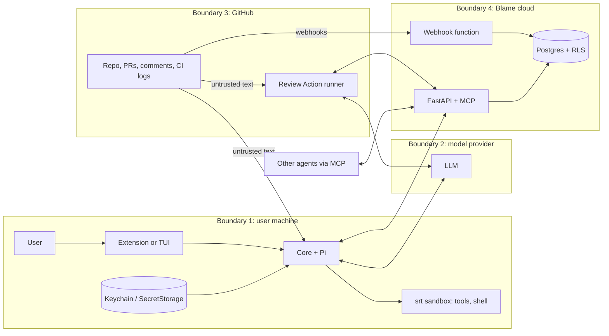

# Blame: Threat Model (STRIDE-lite)

Version v0.1, November 13, 2026. Owner: Forge; review by Davinci. Design-time model; the code audits recorded in `SECURITY.md` later confirm each control (PRD R-SEC-7). Architecture: [ARCHITECTURE.md](ARCHITECTURE.md).

## 1. Scope and assets

| Asset | Why it matters |
|---|---|
| A1 User provider keys and ChatGPT tokens | Direct spend and account access |
| A2 Source code and diffs | Customer IP |
| A3 Learning record and brain | Tenant data; integrity drives the agent's behavior |
| A4 GitHub App private key, webhook secret, Blame tokens | Access to every installed repo |
| A5 The user's machine and repos | The agent executes commands there |
| A6 Proof chart integrity | The product's core claim |

## 2. Data flow and trust boundaries

Untrusted inputs: everything in the repo (files, README, AGENTS.md, skills), PR titles and bodies, review comments, issue text, CI logs, changelogs, fetched docs pages, model output, and MCP requests.

## 3. Threats

Risk = likelihood x impact on a High, Medium, Low scale (OWASP Risk Rating, simplified). IDs are referenced from tests.

| ID | STRIDE | Threat | Element | Risk | Mitigation | Verified by |
|---|---|---|---|---|---|---|
| T-01 | T, E | **Prompt injection** from repo files, PR text, review comments, CI logs or changelogs makes the agent run commands, leak keys, or the reviewer approve or stay silent | Core, Action | High | Untrusted text is wrapped and labeled as data; it never selects tools. Autonomy gate classifies actions independently of model reasoning; risky classes always ask below L3, safe zones always ask. Sandbox egress allow-list stops exfiltration even if the model complies. Reviewer has no tools. Lesson and decision extraction requires a verbatim quote check and human confirmation before injection | Injection eval suite (REVIEWER_AND_BRAIN section 6), zero tolerance |
| T-02 | I | **Key leak** to logs, telemetry, model context, the brain or commits | Core, API | High | Keys only in SecretStorage or keychain, passed in memory; Pi `auth.json` not written (TRD FR-KEY-2); redaction on every tool result; gitleaks pre-commit for agent commits and in CI; telemetry off by default; Sentry scrubbing | Planted fake key test (PRD F17), gitleaks job |
| T-03 | S, E | **Claude subscription misuse** via Pi's built-in Anthropic OAuth | Core | Medium (policy) | Login method removed from the exposed provider list | Unit test asserts absence |
| T-04 | E | **Agent exceeds earned level** (writes outside workspace, network calls, force-push to shared branches) | Core | High | Effective permission = min(preset, earned trust), safe zones, budget, credential scope (R-AUTO-2); force-push only on Blame-created `blame/*` branches (TRD C-5) | Policy unit tests with 3-level and 5-level fixtures; PRD F4 approval tests |
| T-05 | E | **Sandbox escape**: symlink out of workspace, writes to `~/.ssh` or shell profiles, egress through DNS or a child process, fork bomb | srt | High | `srt` profiles per preset; Autonomous refuses without sandbox (R-AUTO-4); CPU, memory, time limits; known Windows limitations tracked | Escape suite on Windows, macOS, Linux before FUR (ADR-0005) |
| T-06 | I | **Cross-tenant read or write** through IDOR, missing filter, or a child row pointing at another tenant's parent | API, DB | High | RLS forced on every tenant table, fail closed when no tenant context; compound `(org_id, id)` foreign keys; org derived from token and membership, never from the body. Schema and RLS checked on Postgres 17 + pgvector on Nov 13, 2026 (cross-tenant insert rejected, compound FK rejected a cross-tenant link) | Cross-tenant suite in `db.yml`, release gate |
| T-07 | S | **Installation hijack**: attacker binds someone else's GitHub installation or repo to their org | API | Medium | Install callback requires a signed, single-use `state` tied to the signed-in user's org; `repositories` unique per org, not globally; installation verified with GitHub before binding | Integration test with forged state |
| T-08 | S, T, R | **Forged or replayed webhooks** | Edge function | Medium | HMAC `X-Hub-Signature-256` over the raw body with constant-time compare; dedupe on `X-GitHub-Delivery` (same ID on redelivery) ([GitHub docs](https://docs.github.com/en/webhooks/using-webhooks/best-practices-for-using-webhooks)); reject unsigned | Unit tests: bad signature, duplicate delivery |
| T-09 | E, I | **Reviewer workflow leaks secrets** to fork PR code | Action | High | `pull_request` only, never `pull_request_target`; reviewer never runs repo code; least permissions; actions pinned by SHA | Workflow lint in CI (actionlint plus a custom check) |
| T-10 | S | **Stolen Blame or MCP token** used from elsewhere | API | Medium | 15-minute access tokens, rotating refresh with family revocation on reuse, MCP tokens max 1 h and repo-scoped, server-side revocation check on every request, stdio `blame mcp` keeps tokens out of config files | Revocation test per credential type (PRD F5) |
| T-11 | R | **Repudiation**: no record of what an agent did | Core, API | Medium | Append-only audit events (no UPDATE or DELETE grants), client event IDs, JSONL export | Grant test; export test |
| T-12 | T | **Proof chart gaming**: lessons Proven by inactivity, or recurrences hidden by bad matching | API | Medium | Exposure requirement, evidence bound to SHA and run URL, regressions always shown, matcher precision and recall measured, human confirms Regressed | Chart rule unit tests; matcher eval |
| T-13 | T | **Brain poisoning**: a malicious PR comment becomes a Confirmed "decision" that steers later tasks | Brain | Medium | Draft until a human confirms; verbatim quote check; source link shown at injection; staleness flags | Injection suite includes poisoned decision |
| T-14 | T | **Supply chain**: malicious or typosquatted npm or PyPI package, compromised Pi release, compromised GitHub Action | Build | Medium | Lockfiles, exact Pi pins, `npm ci --ignore-scripts` where possible (Pi itself documents installing without lifecycle scripts), `npm audit` and `pip-audit`, Dependabot alerts, actions pinned by SHA, npm publish with provenance | `security.yml` |
| T-15 | D | **Cost exhaustion**: runaway loop burns the user's key, or the Action burns their minutes | Core, Action | Medium | Budget hard stop and loop rule (F15); Action timeout and concurrency cancel; per-token API rate limits | F15 tests |
| T-16 | I | **Over-collection**: evidence stores full source files or secrets | API | Medium | Excerpts only (about 200 lines, R-RET-3), redaction before upload, 90-day retention (pending D7), repo disconnect purge within 24 h, account deletion within 30 days | Retention job tests |
| T-17 | S | **Malicious workspace extensions or MCP config** loaded by Pi (`.pi/` or `.blame/` in a cloned repo) | Core | Medium | Keep Pi's project-trust prompt on for Blame's config dir; never auto-trust ([Pi security doc](https://github.com/earendil-works/pi/blob/main/packages/coding-agent/docs/security.md)) | Test: untrusted repo with an extension does not load it |
| T-18 | I | **Webview XSS** in the extension renders model or repo markdown | Extension | Medium | Strict CSP with nonces, no inline scripts, markdown sanitized, `localResourceRoots` limited | Extension test with hostile markdown |
| T-19 | E | **Tool runs without the autonomy gate**: a Pi code path executes a tool without calling Blame's `tool_call` hook, or a hook failure lets it run | Core | High | `tool_call` hook is the gate; every tool Blame turns on is a guarded copy whose `execute` refuses a call with no matching one-shot allow decision (same id, tool and input) and records an `execution_violation`; `tool_execution_end` without a gate decision is recorded too; session creation fails if a Blame extension fails to load. Audit in section 3.1 | `packages/core/test/execution-guard.test.ts` (T-19) |

### 3.1 Gate coverage audit (Pi 1.5.2, 2026-11-14)

Read from the installed `pi-agent-core` `agent-loop.js`, `pi-coding-agent` `core/agent-session.js` and `core/extensions/runner.js`. Pi calls the session's `beforeToolCall`, which runs every extension's `tool_call` handler, in `prepareToolCall`, before `execute`. Rows marked (tested) have a test in `execution-guard.test.ts`; the others are from reading the source.

| Path | What Pi 1.5.2 does | Bypass? |
|---|---|---|
| Sequential and parallel tool calls (tested, parallel) | Each call is prepared (hook awaited) before any execute; parallel mode prepares all calls first, then runs the prepared ones | No |
| Hook throws or rejects (tested, gate error) | `_beforeToolCall` rethrows; `prepareToolCall` catches and returns an error result, so the tool does not run. Blame's gate also catches its own errors and blocks | No (fails closed) |
| Hook slow or approval pending | The loop awaits the hook; Blame's approval has a timeout that resolves to deny | No |
| Unknown tool, invalid arguments, truncated (max tokens) message | Error result without the hook and without execute; `tool_execution_start` and `tool_execution_end` are still emitted, which is why `tool_execution_end` alone is not proof of a run | No |
| Nested calls (`ctx.executeTool` from a tool) | `runToolCall` with the same `beforeToolCall` (with `parentToolCallId`) | No |
| Steer, follow-up, auto-retry, compaction | Same agent loop; retry re-requests the model and never re-runs earlier calls; compaction runs no tools | No |
| Session resume | Tool calls in history are not re-executed | No |
| **No `tool_call` handler registered** (tested, `extension-load-error.test.ts`) | `_beforeToolCall` returns undefined when `hasHandlers("tool_call")` is false, so every tool runs ungated. Happens if Blame's gate extension fails to load | **Yes, conditional.** `createBlameSession` now throws when any Blame extension reports a load error, and the guarded tools still refuse calls with no allow decision |
| `event.input` mutated after the gate decided (tested, guard unit) | Pi passes the same object to `execute` and does not re-validate | Possible only through another in-process extension (Blame loads none). The guard compares the input to the snapshot taken at the decision and blocks a mismatch |
| User shell (`AgentSession.executeBash`, RPC `bash`, `!` commands) | Runs a command directly, never through `tool_call` (only the `user_bash` event) | **Yes, by design.** It is a user action, not an agent tool call. Blame's engine protocol (ADR-0006) has no such method, and hosts must never pass webview or model text to it |
| Direct `tool.execute()` by in-process code (tested) | No hook | Blocked by the guard and recorded as `execution_violation` |

The sandbox (ADR-0005), not the gate, is the boundary for whatever a permitted `bash` command does afterwards, including background processes.

## 4. Privacy notes (LINDDUN-lite)

Personal data in scope: GitHub usernames and emails, commit authorship in evidence, audit events tied to users. Controls: data page (R-RET-1), minimization (T-16), deletion (R-RET-6, R-RET-7), telemetry opt-in (R-RET-8). No data sold or shared; no model training on customer data by Blame.

## 5. Accepted risks (MVP)

- Companion mode `check_action` is advisory; Blame cannot block another vendor's tool calls (PRD 6.1). Shown plainly in the product.
- Users on free private GitHub repos cannot use branch protection or rulesets ([GitHub docs](https://docs.github.com/en/repositories/configuring-branches-and-merges-in-your-repository/managing-protected-branches/about-protected-branches)); merge safety there depends on humans merging PRs.
- `srt` is pre-1.0; escape suite plus fallbacks mitigate.

## 6. Mitigation to test map

Every T-ID above appears in at least one test name (`test_T06_*`, `t05.escape.*`). `SECURITY.md` records audit results against this list before FUR and before MVP launch.
